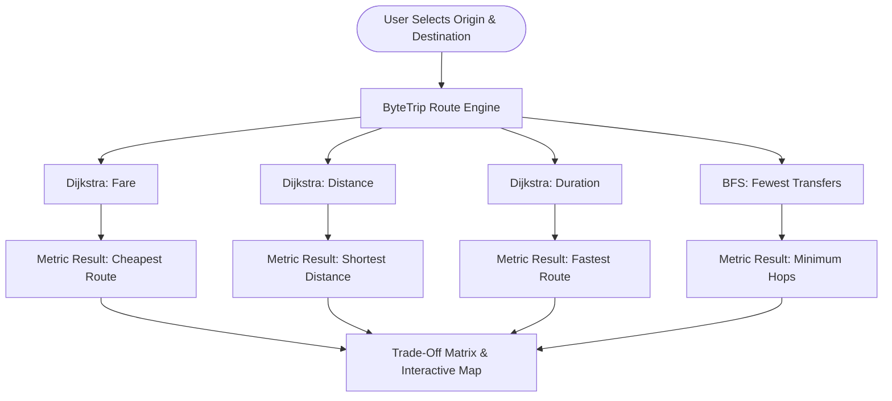

<div align="center">

# 🗺️ ByteTrip: Travel Route Finder
### Intelligent Multi-Objective Inter-District Transit Route Optimization for Bangladesh

[](https://python.org)
[](https://flask.palletsprojects.com/)
[](tests/)
[](https://en.wikipedia.org/wiki/Dijkstra%27s_algorithm)
[](#dataset-architecture--etl-pipeline)

> *"Code your route, Byte your trip."*

</div>

---

## 📋 Table of Contents
- [Executive Overview](#-executive-overview)
- [Key Features](#-key-features)
- [Algorithmic Architecture](#-algorithmic-architecture)
  - [1. Dijkstra's Algorithm (Weighted Metrics)](#1-dijkstras-algorithm-weighted-metrics)
  - [2. Breadth-First Search (Minimum Transfers)](#2-breadth-first-search-minimum-transfers)
  - [3. Algorithmic Complexity Comparison](#3-algorithmic-complexity-comparison)
- [Dataset Architecture & ETL Pipeline](#-dataset-architecture--etl-pipeline)
  - [Sanitization Rules](#sanitization-rules-clean_routespy)
  - [Geographic Coordinate System](#geographic-coordinate-system)
- [System Architecture & Directory Structure](#-system-architecture--directory-structure)
- [REST API Reference](#-rest-api-reference)
  - [1. List Districts & Coordinates](#1-get-apidistricts)
  - [2. Calculate Optimal Routes](#2-get--post-apiroutes)
  - [3. Network Graph Topology](#3-get-apigraph)
- [Installation & Quickstart](#-installation--quickstart)
  - [Prerequisites](#prerequisites)
  - [Setup Guide](#setup-guide)
  - [Configuration](#configuration)
- [Verification & Automated Test Suite](#-verification--automated-test-suite)
- [User Interface & Interactive Visualizer](#-user-interface--interactive-visualizer)
- [Project Report & Academic Attribution](#-project-report--academic-attribution)

---

## 🌟 Executive Overview

Navigating inter-district public transport across Bangladesh presents travelers, commuters, and logistics operators with complex trade-offs. Passengers frequently struggle to answer practical questions:
* *Which route is cheapest when on a tight budget?*
* *Which path covers the lowest geographical mileage?*
* *Which connection minimizes travel duration to reach the destination fastest?*
* *Which itinerary requires the fewest bus transfers to avoid transfer fatigue?*

Standard commercial navigation platforms typically focus on direct highway road navigation for private passenger vehicles, failing to account for multi-modal public transit constraints, transfer hubs, and fare differentials. 

**ByteTrip** solves this challenge by modeling Bangladesh's inter-district transit system as a multi-attribute weighted graph $G = (V, E)$. It evaluates every origin-destination query from four independent optimization perspectives:
1. **Cheapest Path** (Fare in Bangladeshi Taka, Tk)
2. **Shortest Distance** (Kilometers, km)
3. **Fastest Route** (Duration in minutes)
4. **Fewest Transfer Legs** (Direct hops/connections)

---

## ✨ Key Features

- **Multi-Perspective Optimization**: Evaluates four distinct optimization goals simultaneously rather than forcing an artificial weighted sum.
- **Interactive Route Visualization**: Integrated Leaflet.js interactive map plotting route polylines, start/end markers, and intermediate transfer stops across Bangladesh's 64 districts.
- **Speed vs. Cost Trade-Off Matrix**: Computes quantifiable trade-off insights (e.g., *"The fastest route saves 45 minutes for 120 Tk extra fare"*).
- **Automated Data Cleaning Pipeline (`clean_routes.py`)**: Sanitizes raw legacy transit data, repairs corrupted fare entries, standardizes district spelling discrepancies, and deduplicates undirected edges.
- **RESTful JSON API**: Programmatic endpoints (`/api/districts`, `/api/routes`, `/api/graph`) allowing integration with external web, mobile, or data science clients.
- **Working-Directory Independent**: Pathlib-based asset resolution ensuring the application runs consistently across any execution environment or testing harness.
- **Zero-Dependency Core Routing**: Graph algorithms use standard Python libraries (`heapq`, `collections.deque`, `pathlib`) for deterministic, fast in-memory execution.
- **Robust Automated Verification**: 15 comprehensive unit and integration tests covering algorithmic correctness, edge cases, data constraints, and API contracts.

---

## 🧠 Algorithmic Architecture

The routing engine operates over an undirected, non-negatively weighted multigraph $G = (V, E, W)$, where:
- $V$: The set of $|V| = 64$ districts of Bangladesh.
- $E$: The set of $|E| = 148$ physical transit corridors connecting neighboring districts.
- $W(e) = (c_e, d_e, t_e)$: Edge weight vector containing Fare $c_e \ge 0$, Distance $d_e > 0$, and Duration $t_e > 0$.



### 1. Dijkstra's Algorithm (Weighted Metrics)

Dijkstra's Algorithm is executed three times per search query to determine the exact global minimum for each continuous weight metric $w \in \{\text{cost}, \text{distance}, \text{time}\}$.

- **Data Structure**: Min-Priority Queue implemented using Python's binary heap (`heapq`).
- **State Representation**: `(accumulated_weight, current_district)`.
- **Relaxation Step**:
  $$\text{If } \text{dist}[u] + w(u, v) < \text{dist}[v] \implies \text{dist}[v] \gets \text{dist}[u] + w(u, v), \quad \text{parent}[v] \gets u$$
- **Stale Entry Elimination**: When a node is popped with `current_distance != distances[node]`, it is immediately bypassed, preserving $O((|V| + |E|) \log |V|)$ time complexity without requiring a mutable decrease-key priority queue.

### 2. Breadth-First Search (Minimum Transfers)

While Dijkstra optimizes continuous edge weights, travelers with heavy luggage or families often prioritize **minimizing vehicle transfers (bus switches)** regardless of whether the physical road distance is slightly longer.

- **Data Structure**: First-In, First-Out (FIFO) queue implemented with `collections.deque`.
- **Mechanism**: Explores nodes in strict order of topological hop count from the origin.
- **Guaranteed Invariant**: The first time the destination node $t$ is dequeued, the path traversed contains the absolute minimum number of edges (legs).
- **Secondary Accumulation**: Edge attributes along the BFS path are summed post-traversal to provide informative totals (fare, distance, duration) alongside the hop count.

### 3. Algorithmic Complexity Comparison

| Algorithm | Optimization Target | Time Complexity | Auxiliary Space | Optimality Guarantee |
| :--- | :--- | :--- | :--- | :--- |
| **Dijkstra (Cost)** | Minimum Fare (Tk) | $\mathcal{O}((\|V\| + \|E\|) \log \|V\|)$ | $\mathcal{O}(\|V\|)$ | Mathematically optimal fare |
| **Dijkstra (Distance)** | Minimum Distance (km) | $\mathcal{O}((\|V\| + \|E\|) \log \|V\|)$ | $\mathcal{O}(\|V\|)$ | Mathematically optimal distance |
| **Dijkstra (Time)** | Minimum Duration (mins) | $\mathcal{O}((\|V\| + \|E\|) \log \|V\|)$ | $\mathcal{O}(\|V\|)$ | Mathematically optimal travel time |
| **BFS (Fewest Legs)** | Minimum Transfers | $\mathcal{O}(\|V\| + \|E\|)$ | $\mathcal{O}(\|V\|)$ | Mathematically optimal hop count |

On the Bangladesh transit graph ($|V| = 64, |E| = 148$):
- Number of heap operations per query: $\le 212$ operations.
- Typical algorithm execution latency: **$< 0.8$ milliseconds** per query.

---

## 📊 Dataset Architecture & ETL Pipeline

The raw dataset (`route_infos.csv`) captures inter-district bus links. However, raw survey and user-contributed transport data often suffer from syntax inconsistencies, naming drifts, and anomalous inputs. 

### Sanitization Rules (`clean_routes.py`)

The ETL script transforms raw data into `route_infos_clean.csv` via deterministic validation rules:

1. **District Name Standardization**: Standardizes historical and alternate spellings:
   - `Borguna` $\to$ `Barguna`
   - `Coxsbazar` $\to$ `Cox's Bazar`
   - `Comilla` $\to$ `Cumilla`
   - `Jessore` $\to$ `Jashore`
   - `Jhalokathi` $\to$ `Jhalokati`
   - `Laksmipur` $\to$ `Lakshmipur`
   - `Lalmonir` $\to$ `Lalmonirhat`
   - `Narshingdi` $\to$ `Narsingdi`
   - `Panchagar` $\to$ `Panchagarh`
   - `Shariyatpur` $\to$ `Shariatpur`
2. **Defensive Data Constraints**:
   - Rejects missing/null entries (`NaN`).
   - Rejects self-loops ($u = v$).
   - Rejects negative edge values.
   - Enforces integer types for fare, distance, and duration.
3. **Fare Calibration**: Historical data recorded certain fares with an accidental $10\times$ multiplier. Fares where $\text{cost} \ge 500$ Tk are scaled down via $\lfloor \text{cost} / 10 \rfloor$. Any residual values $> 500$ Tk are flagged for manual review.
4. **Undirected Edge Deduplication**: Consolidates asymmetric bidirectional records $(u, v)$ and $(v, u)$ by sorting endpoints lexicographically and computing the supremum:
   $$\text{weight}(\{u, v\}) = \max(w(u, v), w(v, u))$$

### Geographic Coordinate System

`district_data.py` maps all 64 districts to their precise WGS-84 geographic coordinates (latitude, longitude). This powers the interactive Leaflet.js mapping interface and enables Euclidean distance heuristics.

---

## 🏗️ System Architecture & Directory Structure

```
ByteTrip-A-Travel-Route-Finder/
│
├── Project Report Group 04.pdf            # Comprehensive academic project report
├── README.md                              # Complete GitHub Flavored Markdown documentation
│
└── ByteTrip-Travel Route Finder/          # Main application package
    ├── app.py                             # Core Flask app, routing algorithms & REST API
    ├── clean_routes.py                    # ETL data sanitization pipeline
    ├── district_data.py                   # 64 Bangladesh district WGS-84 coordinates & corridors
    ├── requirements.txt                   # Production & testing dependencies
    ├── route_infos.csv                    # Raw upstream route dataset
    ├── route_infos_clean.csv              # Sanitized, deduplicated production dataset
    │
    ├── static/                            # Frontend assets
    │   ├── app.js                         # Dynamic DOM, swap logic & Leaflet route renderer
    │   ├── style.css                      # Modern responsive styling, typography & print CSS
    │   ├── background.jpg                 # Background wallpaper asset
    │   └── road.jpg                       # Application branding logo
    │
    ├── templates/                         # Jinja2 presentation templates
    │   ├── index.html                     # Home route planning interface & corridor pills
    │   └── result.html                    # Route comparison table, trade-off cards & map
    │
    └── tests/                             # Quality assurance suite
        └── test_routes.py                 # 15 automated pytest verification tests
```

---

## 🔌 REST API Reference

ByteTrip exposes a lightweight, high-performance RESTful API for programmatic integration.

### 1. `GET /api/districts`
Retrieves all 64 available districts and their WGS-84 geographic coordinates.

**Response:**
```json
{
  "status": "success",
  "total_districts": 64,
  "districts": ["Bagerhat", "Bandarban", "Barguna", "...", "Thakurgaon"],
  "coordinates": {
    "Dhaka": [23.8103, 90.4125],
    "Rajshahi": [24.3745, 88.6042]
  }
}
```

---

### 2. `GET` / `POST /api/routes`
Calculates optimal routes between origin and destination. Accepts URL parameters or JSON body.

**Example Request:**
```bash
curl -X GET "http://127.0.0.1:5000/api/routes?start=Dhaka&end=Rajshahi"
```
*Or via JSON POST:*
```bash
curl -X POST "http://127.0.0.1:5000/api/routes" \
     -H "Content-Type: application/json" \
     -d '{"start": "Dhaka", "end": "Rajshahi"}'
```

**Example Response:**
```json
{
  "status": "success",
  "data": {
    "start": "Dhaka",
    "end": "Rajshahi",
    "same_route": false,
    "comparison": [
      {
        "key": "cheapest",
        "label": "Cheapest",
        "best_legs": false,
        "result": {
          "value": 500,
          "unit": "Tk",
          "legs": 4,
          "path": ["Dhaka", "Gazipur", "Tangail", "Sirajganj", "Natore", "Rajshahi"],
          "totals": { "cost": 500, "distance": 215, "time": 290 }
        }
      },
      {
        "key": "shortest_distance",
        "label": "Shortest distance",
        "best_legs": false,
        "result": {
          "value": 215,
          "unit": "km",
          "legs": 4,
          "path": ["Dhaka", "Gazipur", "Tangail", "Sirajganj", "Natore", "Rajshahi"],
          "totals": { "cost": 500, "distance": 215, "time": 290 }
        }
      },
      {
        "key": "fastest",
        "label": "Fastest",
        "best_legs": false,
        "result": {
          "value": 290,
          "unit": "minutes",
          "legs": 4,
          "path": ["Dhaka", "Manikganj", "Sirajganj", "Natore", "Rajshahi"],
          "totals": { "cost": 520, "distance": 220, "time": 290 }
        }
      }
    ],
    "bfs": {
      "legs": 4,
      "path": ["Dhaka", "Manikganj", "Pabna", "Natore", "Rajshahi"],
      "totals": { "cost": 540, "distance": 230, "time": 305 }
    },
    "trade_offs": {
      "speed_vs_cost": {
        "time_saved_minutes": 15,
        "additional_cost_tk": 20
      }
    }
  }
}
```

---

### 3. `GET /api/graph`
Returns topological graph statistics and connectivity distribution.

**Response:**
```json
{
  "status": "success",
  "network": {
    "nodes_count": 64,
    "undirected_edges_count": 148,
    "directed_edges_count": 296,
    "average_degree": 4.62,
    "highest_connectivity_districts": [
      { "district": "Dhaka", "connections": 8 },
      { "district": "Gazipur", "connections": 7 }
    ]
  }
}
```

---

## 🚀 Installation & Quickstart

### Prerequisites
- Python 3.8 or higher installed
- Git
- Standard web browser (Chrome, Firefox, Edge)

### Setup Guide

1. **Clone or Navigate to the Repository**:
   ```bash
   cd "ByteTrip-Travel Route Finder"
   ```

2. **Create and Activate a Virtual Environment**:
   ```powershell
   # Windows PowerShell
   python -m venv .venv
   .venv\Scripts\Activate.ps1
   ```
   ```bash
   # Linux / macOS
   python3 -m venv .venv
   source .venv/bin/activate
   ```

3. **Install Dependencies**:
   ```bash
   pip install -r requirements.txt
   ```

4. **Verify / Rebuild Clean Route Data**:
   ```bash
   python clean_routes.py
   ```

5. **Start the Development Server**:
   ```bash
   python app.py
   ```
   Open your browser and navigate to: **`http://127.0.0.1:5000`**

### Configuration

ByteTrip supports configuration via standard environment variables:

| Variable | Default | Description |
| :--- | :--- | :--- |
| `BYTETRIP_DEBUG` | `0` | Enable Flask debug reloader and stack traces (`1`, `true`, `on`) |
| `BYTETRIP_HOST` | `127.0.0.1` | Network binding interface |
| `BYTETRIP_PORT` | `5000` | Port on which the application listens |

---

## 🧪 Verification & Automated Test Suite

ByteTrip includes an automated test suite implemented in `pytest` to guarantee algorithmic correctness, schema integrity, and API stability.

To execute the full test suite:
```bash
python -m pytest -v
```

### Test Suite Summary (15 Automated Tests):
- `test_dijkstra_finds_each_weighted_optimum`: Verifies Dijkstra produces provably optimal paths across cost, distance, and time on an established synthetic graph.
- `test_dijkstra_supports_string_and_enum_metrics`: Validates input flexibility using integer, string, and `Metric` enum parameters.
- `test_bfs_returns_minimum_legs_and_totals_match_path`: Validates BFS minimum hop count and independent metric summation.
- `test_unreachable_route_is_infinite_and_empty`: Tests disconnected graph behavior, asserting $(+\infty, \emptyset)$ outputs.
- `test_unreachable_path_totals_is_infinite`: Verifies that summing totals over an empty path returns $(+\infty, +\infty, +\infty)$ rather than leaking zeros.
- `test_duplicate_edge_fails_loudly_when_summing_totals`: Confirms duplicate edge collisions raise explicit `ValueError` exceptions.
- `test_same_start_and_end_is_zero`: Tests identity trip condition ($u = u$) returning zero cost, distance, time, and 0 hops.
- `test_graph_and_dropdown_contain_the_same_districts`: Guarantees graph adjacency matches the 64-district registry without orphan nodes.
- `test_cleaned_csv_has_unique_undirected_pairs_and_no_self_loops`: Enforces uniqueness of undirected pairs $\{u, v\}$ and absence of loops.
- `test_app_uses_data_path_when_working_directory_changes`: Asserts application path stability when current working directory changes.
- `test_post_validation_and_same_route_message`: Tests HTTP form validation, HTTP 400 rejection for unknown districts, and identity travel notices.
- `test_api_districts_endpoint`: Verifies `/api/districts` returns HTTP 200, exactly 64 districts, and valid coordinates.
- `test_api_routes_get_and_post`: Tests GET query parameters and POST JSON payloads on `/api/routes`.
- `test_api_routes_validation_errors`: Asserts structured JSON 400 errors for missing parameters or invalid district names.
- `test_api_graph_endpoint`: Validates graph network stats endpoint, node counts, and average degree.
- `test_clean_routes_functionality`: Validates the end-to-end execution of `clean_routes()` against a temporary output path.

---

## 💻 User Interface & Interactive Visualizer

### 1. Home Planning Interface
- **District Selectors**: Dropdown menus containing all 64 districts.
- **Popular Corridor Pills**: One-click shortcuts for high-traffic commuter routes (e.g., *Dhaka → Rajshahi*, *Dhaka → Chattogram*, *Dhaka → Sylhet*).
- **Interactive Direction Swap**: Instant origin/destination swapping with dynamic icon rotation.

### 2. Multi-Metric Results Screen
- **Summary Cards**: Side-by-side comparison of Cheapest, Shortest Distance, Fastest, and Fewest Legs routes.
- **Speed vs. Cost Insight**: Automatically calculated trade-off badges highlighting time saved per Taka spent.
- **Interactive Leaflet Map**:
  - Dynamically renders geographic route paths across Bangladesh.
  - Color-coded by metric (Emerald = Cheapest, Blue = Shortest, Amber = Fastest, Purple = Fewest Legs).
  - Numbered hop markers displaying district names and stop order.
  - Interactive tabs to switch map visualization between routing perspectives.
- **Detailed Hop Breakdown Tables**: Segment-by-segment inspection of individual legs with per-leg fare, distance, and duration.
- **Print & Export Tools**: Built-in print stylesheet (`window.print()`) and JSON API export links.

---

## 🎓 Project Report & Academic Attribution

This project is submitted as an algorithmic systems project for:
* **Institution**: **East West University**
* **Department**: Department of Computer Science & Engineering
* **Course**: **CSE 246 (Algorithms)**
* **Section**: 10
* **Academic Session**: Summer 2025
* **Course Instructor**: Sanzana Karim Lora
* **Submission Date**: September 04, 2025

### Group Members (Group No. 04):
| Member Name | Student ID |
| :--- | :--- |
| **MD Abir Rahman** | `2023-3-60-223` |
| **Inteshar Alam** | `2023-3-60-466` |
| **Abdullah Hussain Rida** | `2023-3-60-225` |
| **Tahameed Karim** | `2023-3-60-373` |

### Upstream Attribution
The original raw dataset and initial concept were developed by Abir Rahman Sakin ([ByteTrip-A-Travel-Route-Finder](https://github.com/abirrahman26/ByteTrip-A-Travel-Route-Finder)). This enhanced version provides automated data sanitization, mathematical rigor, expanded algorithmic validation, interactive Leaflet.js mapping, RESTful API architecture, and a comprehensive automated test harness.

---

<div align="center">
  <sub>Developed with ❤️ for CSE 246 (Algorithms) • East West University</sub>
</div>
