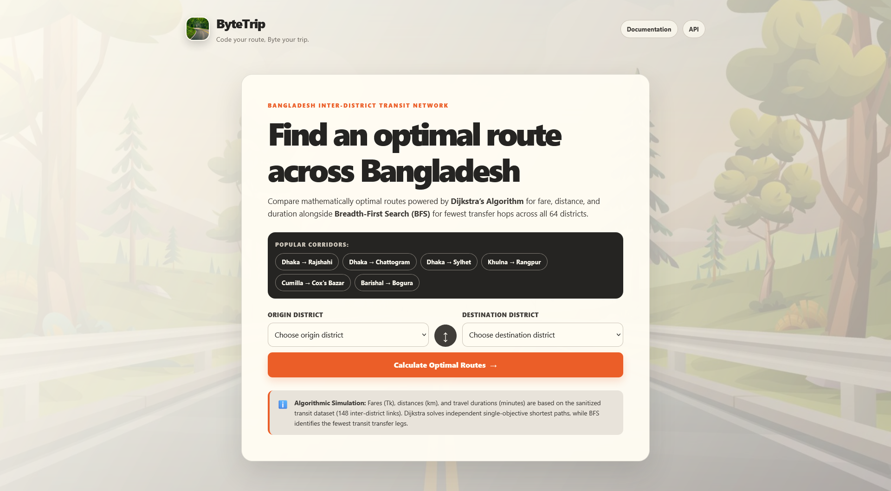

# ByteTrip - Travel Route Finder
 
[](https://www.python.org/)
[](https://flask.palletsprojects.com/)
[](https://docs.pytest.org/)
[](#routing-engine)
 
ByteTrip is a lightweight Flask web application for finding optimal inter-district travel routes across Bangladesh. It compares routes by fare, distance, travel time, and number of transit legs.
 
The application models the transit network as a weighted graph containing 64 districts and 148 cleaned connections. It uses Dijkstra's algorithm for weighted route optimization and Breadth-First Search (BFS) for the fewest-leg route.
 
---
 
## Interface
 

 
---
 
## Features
 
- **Four route perspectives:** cheapest, shortest distance, fastest, and fewest legs.
- **Interactive map:** visualizes each calculated route with Leaflet.
- **Route comparison:** displays fare, distance, duration, transfers, and the complete district path.
- **Trade-off insight:** explains the time saved and additional fare when comparing the cheapest and fastest routes.
- **Popular corridors:** quickly load common origin and destination pairs.
- **REST API:** query districts, routes, and graph metadata as JSON.
- **Responsive interface:** works on desktop and mobile screens.
- **Automated tests:** validates routing algorithms, data handling, and API responses.
---
 
## Technology Stack
 
| Component | Technology |
| :--- | :--- |
| Language | Python 3.9+ |
| Web framework | Flask 3.1 |
| Data processing | pandas 2.2 |
| Front end | HTML, CSS, vanilla JavaScript |
| Map | Leaflet 1.9 |
| Algorithms | Dijkstra's algorithm and BFS |
| Testing | pytest |
 
---
 
## Project Structure
 
```text
ByteTrip-A-Travel-Route-Finder/
+-- ByteTrip-Travel Route Finder/
|   +-- app.py                  # Flask application and routing engine
|   +-- clean_routes.py         # Raw dataset cleaning and deduplication
|   +-- district_data.py        # District coordinates and popular routes
|   +-- route_infos.csv         # Raw route dataset
|   +-- route_infos_clean.csv   # Runtime-ready cleaned route dataset
|   +-- requirements.txt        # Python dependencies
|   +-- data/README.md          # Dataset notes
|   +-- static/
|   |   +-- app.js              # Form behavior and interactive map
|   |   +-- style.css           # Application styles
|   |   +-- background.jpg      # Page background
|   |   +-- road.jpg            # Brand image
|   +-- templates/
|   |   +-- index.html          # Route search page
|   |   +-- result.html         # Route comparison page
|   +-- tests/
|       +-- test_routes.py      # Unit and integration tests
+-- .gitignore
+-- Interface.png               # Application screenshot
+-- Project Report Group 04.pdf
+-- README.md
```
 
Generated files such as Python bytecode, virtual environments, test caches, local secrets, and editor files are excluded by `.gitignore`.
 
---
 
## Routing Engine
 
### Dijkstra's algorithm
 
Dijkstra's algorithm runs independently for three metrics:
 
1. **Cost:** lowest estimated fare in Tk.
2. **Distance:** shortest route distance in km.
3. **Time:** shortest estimated duration in minutes.
Each graph edge stores the fare, distance, and duration for that connection. The algorithm returns both the optimal value and the complete district path.
 
### Breadth-First Search
 
BFS finds the route with the fewest direct transit legs. The fare, distance, and duration for that route are calculated after the path is found.
 
---
 
## Installation and Quickstart
 
### Prerequisites
 
- Python 3.9 or newer
- pip
### Windows PowerShell
 
```powershell
git clone https://github.com/INTE5HAR/ByteTrip-A-Travel-Route-Finder.git
cd "ByteTrip-A-Travel-Route-Finder\ByteTrip-Travel Route Finder"
 
python -m venv .venv
.\.venv\Scripts\Activate.ps1
python -m pip install -r requirements.txt
python app.py
```
 
### Linux or macOS
 
```bash
git clone https://github.com/INTE5HAR/ByteTrip-A-Travel-Route-Finder.git
cd "ByteTrip-A-Travel-Route-Finder/ByteTrip-Travel Route Finder"
 
python3 -m venv .venv
source .venv/bin/activate
python -m pip install -r requirements.txt
python app.py
```
 
Open [http://127.0.0.1:5000](http://127.0.0.1:5000) in a browser.
 
The app uses these environment variables when needed:
 
| Variable | Default | Purpose |
| :--- | :--- | :--- |
| `BYTETRIP_HOST` | `127.0.0.1` | Server bind address |
| `BYTETRIP_PORT` | `5000` | Server port |
| `BYTETRIP_DEBUG` | `0` | Enable Flask debug mode |
 
---
 
## Rebuilding the Clean Dataset
 
The application runs from `route_infos_clean.csv`. If the raw route data changes, regenerate the cleaned file from the project directory:
 
```bash
python clean_routes.py
```
 
The cleaning pipeline standardizes district names, rejects invalid values, normalizes fares, removes self-loops, and deduplicates undirected connections.
 
---
 
## REST API
 
| Endpoint | Method | Description |
| :--- | :--- | :--- |
| `/api/districts` | GET | List all districts and coordinates |
| `/api/routes?start=Dhaka&end=Rajshahi` | GET | Calculate route comparisons |
| `/api/routes` | POST | Calculate routes from a JSON body |
| `/api/graph` | GET | Return graph and connectivity metadata |
 
Example:
 
```bash
curl "http://127.0.0.1:5000/api/routes?start=Dhaka&end=Rajshahi"
```
 
POST body:
 
```json
{
  "start": "Dhaka",
  "end": "Rajshahi"
}
```
 
---
 
## Running Tests
 
From the repository root:
 
```bash
python -m pytest "ByteTrip-Travel Route Finder/tests"
```
 
The current suite contains 15 tests covering:
 
- Dijkstra route selection for all weighted metrics
- BFS fewest-leg paths
- Route totals and edge cases
- Flask pages and API contracts
- Invalid district handling
---
